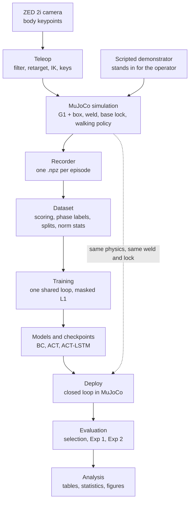

# System map: the core of the project, on one page

A study map of the core components only. Code is named by file and function. For the numbers inside the
pipeline see [DATA_FLOW.md](DATA_FLOW.md); for the models see [MODELS_GUIDE.md](MODELS_GUIDE.md); for how our ACT
compares with the original see [ACT_FAITHFULNESS.md](ACT_FAITHFULNESS.md); for the reasons behind the code see
[DESIGN_NOTES.md](DESIGN_NOTES.md).

## Overview

The project teaches a simulated Unitree G1 humanoid to pick up a box with both hands, carry it to another
platform and put it down, by imitating demonstrations. A person demonstrates in front of a ZED 2i camera: their arm
motion is retargeted to the robot's arms in MuJoCo while keys drive a pre-trained walking policy. Each episode is
recorded as a 48-D state and a 22-D action at 25 Hz. Three policies learn from those episodes, BC, ACT and ACT-LSTM,
and are then run closed loop in the same simulator, on box positions seen during collection (Exp 1) and in a held-out
patch (Exp 2). **Status:** everything is built, but all training data so far is scripted (the scripted demonstrator
stands in for the operator), and the live ZED recorder has only been tested on a fake camera.

## The whole system

## The stages

**1. Capture: the camera**

| file | role | key functions | input → output |
|---|---|---|---|
| `g1_teleop/zed_source.py` | reads the ZED 2i body tracking | `ZEDSource.grab`, `BodyFrame` | camera → 3-D keypoints (BODY_38) |
| `g1_teleop/synthetic_source.py` | a fake camera, for runs with no ZED | `SyntheticSource.grab` | saved or synthetic take → the same frames |

**2. Teleop: from a person to robot commands**

| file | role | key functions | input → output |
|---|---|---|---|
| `run_integrated_combined.py` | the teleop control loop | `open_session`, `reset_for_episode`, `run_loop`, `FrameGrabber` | frames + keys → controls, every physics step |
| `g1_teleop/teleop.py` | one camera frame to one arm pose | `TeleopController.step` | keypoints → joint targets |
| `g1_teleop/onceuro.py` | smooths keypoint jitter | `KeypointFilter` | raw → filtered keypoints |
| `g1_teleop/retargeting.py` | maps human arm directions onto the robot's arm lengths | `compute_arm_targets` | keypoints → elbow and wrist targets |
| `g1_teleop/ik.py` | inverse kinematics: 4 joints per arm | `solve_arm_ik` | elbow and wrist targets → joint angles |
| `locomotion_input.py` | keys to a walking command | `KeyboardCommand` | keys → (vx, vy, wz) |

**3. Simulation: the robot and the task**

| file | role | key functions | input → output |
|---|---|---|---|
| `scene.xml` | the G1, box and two platforms | loaded by `load_model` in `g1_teleop/contact_contract.py` | the physics model |
| `g1_data/reset.py` | starts every episode | `reset_episode`, `reset_policy_state`, `state_fingerprint` | seed → a clean start |
| `g1_teleop/box_reset.py` | box position from a seed | `sample_box_pose`, `in_heldout` | seed → box pose |
| `g1_teleop/grasp.py` | the grasp, a weld with a geometric gate | `GraspWeld.update` | gripper command + palm poses → weld on or off |
| `g1_teleop/base_lock.py` | holds the pelvis during manipulation | `BaseLock.lock`, `BaseLock.release` | decision → pelvis weld |
| `g1_data/phases.py` | decides when to lock, from the state alone | `LockPredicate.update`, `LockConfig` | state → lock or release |
| `g1_data/scripted_demo.py` | the scripted demonstrator | `run_episode`, `PoseBook` | seed → a full demonstration |

**4. Recorder: from a running sim to a file**

| file | role | key functions | input → output |
|---|---|---|---|
| `g1_data/spec.py` | **the contract**: every index, name, mask and clip | `SpecLayout.build`, `grip_label_next_weld`, `NormStats` | simulator → state, action |
| `g1_data/recorder.py` | observes the loop without changing it, writes the file | `EpisodeBuffer.tick`, `EpisodeBuffer.save`, `ScriptedRecorder`, `TeleopRecorder`, `load_episode` | ticks → `.npz` |
| `tools/record_episodes.py` | records scripted episodes | `cmd_record`, `run_one`, `verdict` | seeds → `recordings/<folder>/` |
| `tools/record_teleop_live.py` | records a live operator, one episode per seed | `cmd_record`, `run_episode`, `finish_episode` | ZED + operator → accepted `.npz` |
| `g1_data/ledger.py` | who accepted what | `EpisodeLedger` | decisions → `ledger.jsonl` |

**5. Dataset: from files to something trainable**

| file | role | key functions | input → output |
|---|---|---|---|
| `tools/build_dataset.py` | runs the steps below | `cmd_stage`, `cmd_score`, `cmd_split`, `cmd_norm` | a folder of episodes → splits + stats |
| `g1_data/dataset.py` | seeds, splits, normalization, refusals | `partition_seeds`, `stratified_split`, `nested_split`, `fit_norm_stats`, `save_norm_stats`, `load_norm_stats` | episodes → `data/processed/*` |
| `g1_data/success.py` | the four success criteria, from recorded data | `evaluate`, `attribute` | one episode → grasp, lift, transport, place |
| `g1_data/phase_label.py` | derives phases after the fact | `label_episode` | recorded state → a phase per tick |

**6. Training: one loop for every model**

| file | role | key functions | input → output |
|---|---|---|---|
| `tools/train_bc.py` | the shared trainer, for **all** models; `--model` chooses | `main`, `cmd_train`, `cmd_overfit10`, `_model_config`, `_load`, `_make_model` | arguments → a run folder |
| `g1_model/loader.py` | episodes to samples | `ChunkDataset`, `collate_chunks` | `.npz` + norm stats → (window, chunk) |
| `g1_model/history.py` | adds the episode history for ACT-LSTM | `HistoryChunkDataset`, `HistoryObs`, `collate_history` | samples → samples + states 0..t |
| `g1_model/train.py` | the loop, the loss, scoring, checkpoints | `train`, `masked_l1`, `forward_loss`, `score_deployment`, `save_checkpoint`, `load_checkpoint` | model + data → `runs/<run>/` |

**7. Models**

| file | role | key functions | input → output |
|---|---|---|---|
| `g1_model/models.py` | BC, and chunked BC at K > 1 | `BCPolicy`, `BCConfig`, `build_bc` | (B, 12, 48) → (B, 1, 22) |
| `g1_model/act.py` | ACT: a CVAE with a transformer decoder | `ACTPolicy`, `ACTConfig`, `act_loss`, `TemporalEnsembler` | (B, W_o, 48) → (B, 100, 22) |
| `g1_model/act_memory.py` | ACT-LSTM: ACT plus an LSTM over the whole episode | `ACTLSTMFullPolicy`, `ACTFullHistoryConfig` | current state + history → (B, 100, 22) |
| `g1_model/policies/__init__.py` | a map from thesis names to the real code | `HEADLINE`, `ABLATION`, `BY_CODE_NAME` | names → entry modules |

**8. Deploy: a trained policy drives the robot**

| file | role | key functions | input → output |
|---|---|---|---|
| `tools/deploy.py` | runs one checkpoint closed loop, one seed per episode | `CheckpointPolicy.act`, `deploy_episode`, `observe`, `post_process` | checkpoint + seeds → one JSONL record per episode |

**9. Evaluation: which checkpoint, and how good**

| file | role | key functions | input → output |
|---|---|---|---|
| `tools/eval_scripted.py` | selection, then Exp 1 and Exp 2, one deploy at a time | `select`, `evaluate`, `deploy` | run folders → `selection.json`, `exp1.jsonl`, `exp2.jsonl` |
| `data/eval/select_seeds.json` | the fixed seed lists, also `exp1_seeds.json`, `exp2_seeds.json` | written by `partition_seeds` | the same box positions for every policy |

**10. Analysis: the results**

| file | role | key functions | input → output |
|---|---|---|---|
| `tools/analyze_experiments.py` | tables, statistics, figures, under thesis names. Read-only | `analyze`, `wilson`, `fisher`, `generalization_gap` | eval folders → `report.md`, CSVs, figures |
| `tools/make_final_report.py` | the thesis's own report, with the position-level paired test. Read-only | `build`, `position_counts`, `paired_test`, `position_tests` | eval folders → `runs/scripted_v3/analysis_final/` |

## Follow one tick

One tick is 0.04 s: 20 physics steps at 0.002 s each. The walking policy runs at 50 Hz, so it can run twice per tick.

### During teleop (`run_integrated_combined.py`, `run_loop`)

At the first physics step of the tick:

1. **Lock.** `SpecLayout.build_state` reads the state, `LockPredicate.update` decides, and `BaseLock` locks or releases.
2. **Write the controls.** Legs get a PD torque toward their target (or toward the default pose while locked). Arms get
   the current `arm_targets`. Pads stay at 0.
3. **Weld.** `GraspWeld.update` applies the operator's `grasp_cmd`, if the palms pass the geometric gate.
4. **Record.** `mj_step` is wrapped: at entry, `TeleopRecorder` calls `EpisodeBuffer.tick`, which stores `state[t]` and
   `action[t]`. This happens only on this one step of the 20, and it changes nothing.
5. **Step.** `mj_step` advances 0.002 s.

Steps 2, 3 and 5 repeat for all 20 physics steps. Every 10th step (50 Hz), also:

6. **Pace** the simulation to the wall clock.
7. **Walk.** Unless locked, compute `active_cmd` from the keys or station keeping, then query the walking policy for new leg targets.
8. **Arms.** `FrameGrabber.latest` reads the newest camera frame without waiting, because the camera runs on its own
   thread. A new frame goes through `TeleopController.step`, giving new `arm_targets`, which can change partway through
   a tick. If no pose has been applied for 0.4 s the tick is marked `tracking_ok = 0`.
9. **Keys.** `KeyboardCommand` updates the walking command.

### During deploy (`tools/deploy.py`, `deploy_episode`)

Once at the start of the tick:

1. **Lock.** The same `LockPredicate` and `BaseLock` as collection.
2. **Observe.** `observe` builds the 48-D state, after the lock update.
3. **Decide.** `CheckpointPolicy.act` normalizes, updates the window (or the LSTM's memory), runs the model, ensembles
   the chunk and denormalizes.
4. **Repair.** `post_process` zeroes the untrained dims, thresholds the gripper and clips the velocity.

Then for each of the 20 physics steps:

5. **Write the controls.** Legs PD as in teleop, arms from the action (fixed for the whole tick, unlike teleop), pads at 0.
6. **Weld.** `GraspWeld.update`, the same gate as collection, with the policy's gripper dim.
7. **Step** `mj_step`. Every 10th step, unless locked, the walking policy runs with the action's velocity.
8. **Fall check.** A pelvis below 0.35 m ends the episode at once.

After the 20 steps: once the weld has engaged and released, the episode ends early if `success.evaluate` keeps passing for
2.5 s. Otherwise it runs to the cap (900 ticks for scripted) and the final tick is scored.

## Glossary

| term | meaning |
|---|---|
| **tick** | One recorded and policy step: 0.04 s (25 Hz), or 20 physics steps. Every per-tick array has one row per tick. |
| **chunk** | The K actions a model predicts at once, from tick t forward. K = 100 is 4.0 s; BC has K = 1. |
| **weld** | The grasp. A MuJoCo constraint that attaches the box to the robot, engaged only if the palms pass a geometric gate (`GraspWeld`). A friction grasp did not hold (D11). |
| **base lock** | A weld from the pelvis to the world during manipulation (`BaseLock`, D12). `LockPredicate` engages it from the state alone; `base_locked` shows it to the policy. |
| **seed** | One integer that fixes one episode's box position (`sample_box_pose`). Seed lists are split before collection, so train and test positions cannot leak. |
| **checkpoint** | Saved weights in a run folder: `ckpt_step*.pt` periodically, `best.pt` (lowest validation reconstruction), `last.pt`. `state.pt` also holds the optimizer, for resuming. |
| **temporal ensembling** | The policy is queried every tick, so several chunks predict each tick. `TemporalEnsembler` averages them with exponential weights, the oldest weighted most. Inference only. |
| **normalization** | `(x - mean) / std` per dim, fitted once on the training split, stored beside the data and reused unchanged at deployment. See [DATA_FLOW.md](DATA_FLOW.md). |
| **selection** | Choosing which checkpoint to evaluate, by task success on 20 selection seeds rather than by loss (`select`). Order: successes, place, transport, lift, grasp, placement error; a tie goes to fewer steps. |
| **Exp 1** | The chosen checkpoint on 100 fresh seeds from the training region: can it do the task it trained on? |
| **Exp 2** | The same checkpoint on 100 seeds in a held-out patch of the spawn region, positions never seen in collection: spatial generalization. |

## You can ignore

Skip these on a first read. They support the core, but you do not need them to understand it.

- **Tests:** every `test_*.py`, and the stale `test/` folder.
- **Measurements and one-off fixes:** `tools/analyze_keypoints.py`, `tools/bprime_compare.py`, `tools/bprime_validate.py`,
  `tools/check_palm_orientation.py`, `tools/contact_measures.py`, `tools/convert_grip_label.py`,
  `tools/fix_walkin_attribution.py`, `tools/plot_platform_regions.py`, `tools/rescore_d19.py`,
  `tools/teleop_fix_candidates.py`, `tools/teleop_physics_check.py`, `tools/teleop_throughput.py`, `tools/walk_sweep.py`.
- **Benchmarks and regression proofs:** `tools/bench_long_episodes.py`, `tools/bench_memory_design.py`,
  `tools/check_memory_design_regression.py`, `tools/replay_check.py`, `tools/write_resources.py`.
- **Videos:** `tools/episode_view.py`, `tools/pick_video_episodes.py`, `tools/record_exp_videos.py`,
  `tools/video_common.py`, `tools/video_highlight_reel.py`, `tools/video_side_by_side.py`.
- **Operator and collection helpers:** `tools/backup_recordings.py`, `tools/eval_cap.py`, `tools/pilot_check.py`,
  `tools/readiness_check.py`, `tools/record_keypoints.py`, `tools/record_teleop_episode.py`, `tools/report_extras.py`,
  `tools/sus_score.py`, `tools/teleop_metrics.py`, and the launchers `tools/train_*.ps1` (the exact commands of past runs).
- **Older entry points:** `run_teleop.py`, `run_teleop_combined.py`. `walk_test.py` holds only helpers that the core imports.
- **Dead or evidence-only code:** `g1_teleop/gating.py`, and everything in `locomotion_input.py` except `KeyboardCommand`.
- **Not ours:** `reference/act/` (the original ACT, for comparison) and `unitree_rl_gym/` (only its pre-trained `motion.pt` is used).
- **Outputs:** `runs/`, `recordings/`, `data/`. Open them with `tools/inspect_episode.py` instead of reading them raw.
